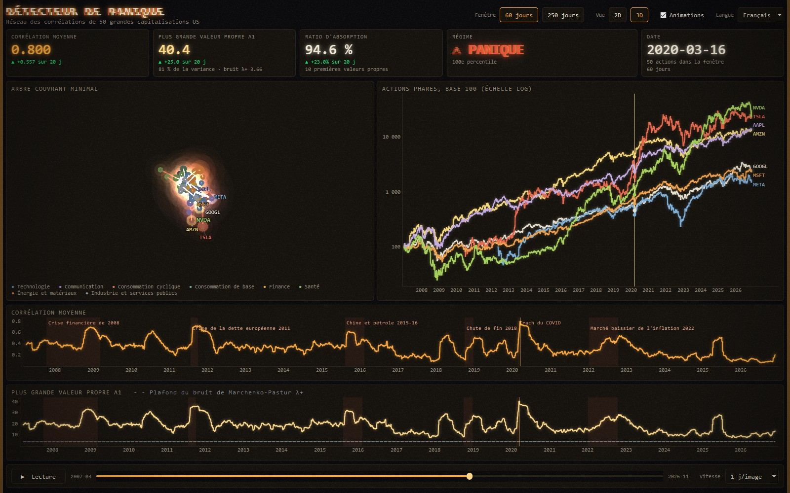
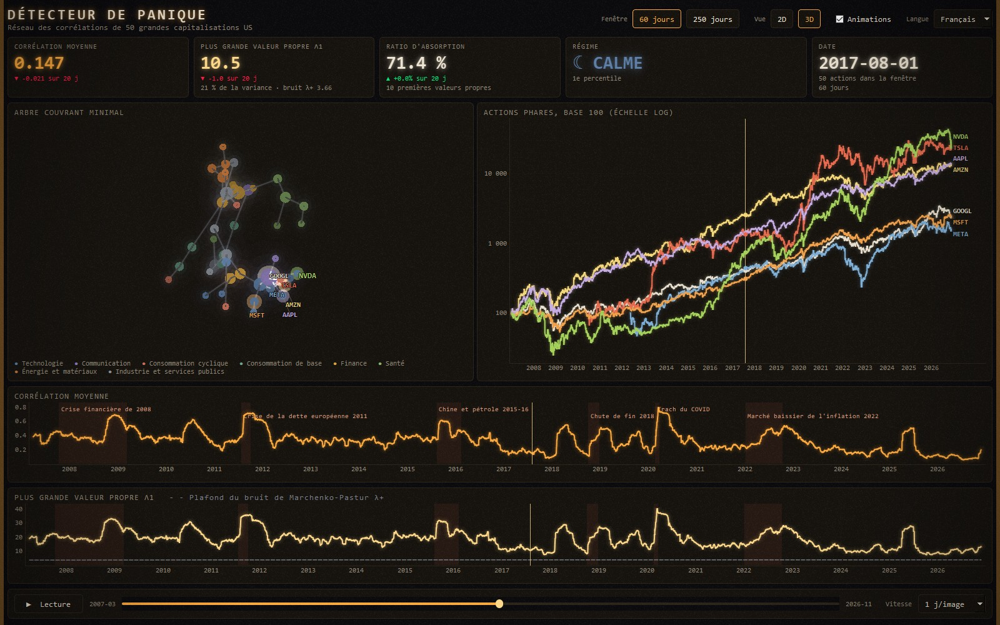
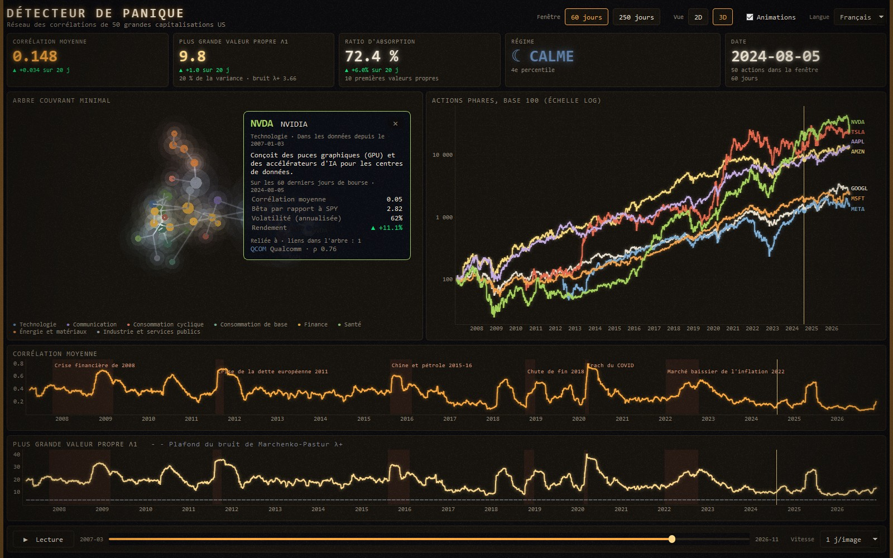
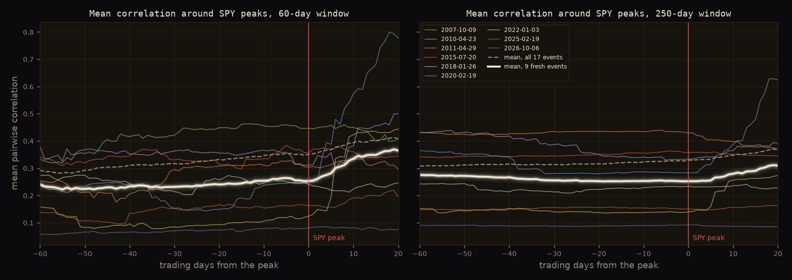

[English](README.md) | [Français](README.fr.md) | [中文](README.zh-CN.md)

# Market Panic Detector

**Quand le marché américain panique, tout se met à bouger ensemble.** Ce projet mesure cette synchronisation sur 50 grandes actions américaines depuis 2007. Il dessine jour après jour le réseau de leurs corrélations dans un dashboard de bureau natif, et teste honnêtement s'il prévient d'un krach.



## L'idée

Un jour calme, les actions bougent assez indépendamment : Apple réagit aux nouvelles d'Apple, Exxon au prix du pétrole. Leur réseau de corrélations est étalé, et chaque secteur forme sa propre branche. En crise, une seule force domine tout (la peur, le besoin de liquidités, les ventes forcées). Les actions montent et baissent ensemble, et le réseau se contracte en un seul bloc.

| Calme : 1er août 2017 | Panique : 16 mars 2020 |
|---|---|
|  |  |
| Corrélation moyenne 0,15, λ1 = 10,5 (21 % de la variance) | Corrélation moyenne 0,80, λ1 = 40,4 (81 % de la variance) |

## Ce que mesure chaque indicateur, simplement

Tous les indicateurs sont calculés chaque jour sur une fenêtre glissante de **60 ou 250 jours de bourse**, à partir des rendements logarithmiques quotidiens, jamais sur les prix.

| Indicateur | En clair |
|---|---|
| **Corrélation moyenne** | La moyenne des 1 225 corrélations entre les 50 actions prises deux à deux. 0 = elles s'ignorent, 1 = elles bougent comme une seule. |
| **Plus grande valeur propre λ1** | La force de la principale influence commune au marché (le « facteur marché »). Avec 50 actions, elle va d'environ 1 (aucune force commune) à 50 (tout se comporte comme une seule action). λ1 / N est la part de tous les mouvements que cette force explique à elle seule. |
| **Ratio d'absorption** (Kritzman et al., 2011) | La part de la variance totale absorbée par les 10 forces les plus fortes (N/5). Élevé = marché fragile, où un choc se propage partout. |
| **Plafond de Marchenko-Pastur λ+** | La plus grande valeur propre que l'on obtiendrait par pur hasard avec N actions et T jours de bruit aléatoire : λ+ = (1 + √(N/T))². Tracé en pointillés : si λ1 est très au-dessus, la force commune est réelle, ce n'est pas du bruit. |
| **Arbre couvrant minimal** (Mantegna, 1999) | Chaque action est reliée à celle qui lui ressemble le plus, avec la distance d = √(2(1 − ρ)). On garde les 49 liens les plus courts qui relient les 50 actions. Des liens courts = un marché serré. |
| **Régime** CALME / TENSION / PANIQUE | La corrélation moyenne du jour, classée **uniquement par rapport aux jours passés** (sans regarder le futur). Sous le 60e percentile : CALME ; du 60e au 90e : TENSION ; au-dessus du 90e : PANIQUE. Seuils configurables. |

## Le dashboard

Une fenêtre native en PySide6 + pyqtgraph, avec OpenGL pour le réseau en 3D. Pas besoin de navigateur.

- **En haut** : panneaux à gros chiffres pour la corrélation moyenne, λ1, le ratio d'absorption, le régime (avec icône) et la date. Chacun indique sa variation sur 20 jours avec ▲ / ▼, jamais la couleur seule.
- **Au centre gauche** : l'arbre couvrant minimal à la date choisie, **en 3D**.
  - Glisser pour tourner autour, molette pour zoomer, clic droit glissé pour déplacer la vue, double-clic pour recadrer. En CALME, il tourne lentement tout seul.
  - Les nœuds sont colorés par secteur, et leur taille dépend du nombre de liens. Les nœuds éloignés sont assombris, pour donner du relief.
  - Les 7 actions phares (NVDA, AAPL, MSFT, GOOGL, AMZN, META, TSLA) ont un halo et une étiquette de leur couleur.
  - Les nœuds gardent des positions stables et glissent d'une date à l'autre.
  - Un bouton **2D / 3D** dans l'en-tête bascule vers une vue à plat. Sans OpenGL, la fenêtre prend d'elle-même la vue 2D.
- **Un clic sur une bulle** ouvre la fiche de l'entreprise :
  - son activité en une phrase (dans les 3 langues) ;
  - les entreprises auxquelles elle est reliée dans l'arbre, avec leur corrélation ρ (un clic ouvre leur fiche) ;
  - sa corrélation moyenne avec les autres actions, son bêta par rapport à SPY, sa volatilité annualisée et son rendement sur la fenêtre.

  La bulle et ses liens sont surlignés, et la fiche suit la date. On la ferme avec ✕ ou `Échap`.
- **Au centre droit** : les cours des 7 actions phares en base 100, en échelle log, avec la ligne de la date.
- **En bas** : la corrélation moyenne et λ1 dans deux graphiques séparés, avec le plafond de Marchenko-Pastur et les crises annotées (2008, 2011, 2015-16, fin 2018, COVID 2020, 2022). En dessous, un curseur temporel avec lecture / pause et vitesse.
- **Interactions** :
  - le survol d'un nœud affiche ticker, nom, secteur et nombre de liens ;
  - un réticule affiche les valeurs sur les graphiques ;
  - un clic sur un graphique saute à cette date ;
  - zoom à la molette sur le réseau, double-clic pour recadrer ;
  - choix de la fenêtre 60 / 250 jours et de la langue **EN / FR / 中文**, à chaud ;
  - les animations peuvent être coupées.



**Ambiance.** Le style reprend la pochette de *I'm Wide Awake* de dxn1al : une nuit blanche sous les lampadaires au sodium.
- **Lumière et couleurs** : un ciel presque noir, une seule lumière ambrée, des gris béton et des bandes ocre sur les côtés.
- **Rendu photo** : des halos flous comme des lampadaires (bokeh) et un léger grain avec les bords assombris.
- **Selon le régime** :
  - CALME : les nœuds respirent lentement en bleu nuit (un cycle toutes les 3 s) ;
  - TENSION : la pulsation s'accélère et les liens virent à l'ambre ;
  - PANIQUE : la pulsation s'emballe, les liens prennent le rouge des feux arrière, et le titre comme le badge de régime « glitchent ».

## Installation

Python 3.11 ou plus récent.

```powershell
cd MarketPanicDetector
py -3.11 -m venv .venv            # ou : python3 -m venv .venv
.venv\Scripts\activate            # macOS / Linux : source .venv/bin/activate
pip install -r requirements.txt
pip install -e .
```

## Utilisation

```powershell
python scripts/run_analysis.py    # télécharge les cours, précalcule tout, écrit reports/findings.md
python -m panic_detector          # ouvre le dashboard
```

- **Données** : le premier lancement télécharge les clôtures ajustées quotidiennes de Yahoo Finance (`yfinance`) en un seul appel groupé. Il les met en cache dans `data/cache/` et réessaie avec un délai croissant en cas de limite de requêtes. Les lancements suivants fonctionnent hors ligne.
- **Retélécharger** : ajoutez `--refresh` à l'une ou l'autre commande.
- **Résultats précalculés** : métriques, arbres et positions des nœuds sont précalculés une fois (environ 90 s) puis mis en cache. Le dashboard se contente de les lire.
- **Options du dashboard** :
  - `--window 250` : démarrer sur la fenêtre de 250 jours ;
  - `--lang fr` ou `--lang zh_CN` : démarrer en français ou en chinois ;
  - `--date 2020-03-16` : démarrer à cette date ;
  - `--view 2d` ou `--view 3d` : vue du réseau au démarrage (par défaut : 3D si OpenGL est disponible) ;
  - `--no-animations` : démarrer sans animations.
- **Clavier** : `Espace` lance ou met en pause la lecture, `←` `→` avancent ou reculent d'un jour, `Échap` ferme la fiche entreprise.
- **Captures** : `python scripts/make_screenshots.py` régénère les images de `docs/img/`.
- **Réglages** : univers dans `config/universe.yaml` ; fenêtres, seuils et crises dans `config/settings.yaml`.

## Résultats : l'indicateur anticipe-t-il les crises ?

**Non. Il réagit pendant la crise, il ne l'anticipe pas.** Le rapport complet, avec tableaux et graphiques, est dans [reports/findings.md](reports/findings.md) (en anglais, données jusqu'au 23 novembre 2026).

- **Événements** : on compte 17 baisses de SPY de plus de 10 % depuis 2007. Neuf sont « indépendantes », c'est-à-dire qu'elles ne sont pas une réplique d'une chute précédente.
- **Au sommet** : au sommet de SPY de chaque baisse indépendante, le régime à 60 jours était CALME 8 fois (la 9e était encore en période de chauffe en 2007), jamais TENSION ni PANIQUE.
  - La variation de la corrélation sur les 60 jours avant le sommet était ordinaire : médiane au 62e percentile de toutes les variations sur 60 jours.
- **Après le sommet** : seules 4 des 9 baisses indépendantes ont atteint la PANIQUE, toujours *après* que SPY avait déjà perdu 10 %, avec 2 à 32 jours de bourse de retard (médiane 6). 85 % des jours de PANIQUE tombent quand SPY est déjà à plus de 10 % sous son plus haut.
- **Aucune prévision** : la variation de la corrélation moyenne sur 20 jours ne prédit pas SPY sur les 20 jours suivants. Sur des échantillons sans chevauchement, r = −0,02 (p = 0,77) ; avec Newey-West, p = 0,60.
- **Un seul résultat faible, de signe inverse** : le *niveau* de la corrélation sur 250 jours est significatif avec Newey-West (p = 0,015), mais pas sans chevauchement (p = 0,064), et c'est 1 test sur 6. Une corrélation élevée a été suivie de rendements un peu *plus hauts*, ce qui rejoint Pollet & Wilson (2010). Ce n'est pas une alerte de krach.
- **Sur la même période, le lien est fort** : la corrélation monte pendant les semaines mêmes où le marché baisse (r = −0,49).



La corrélation moyenne et λ1 sont un **thermomètre, pas un baromètre**. Ils montrent précisément à quel point le marché est synchronisé maintenant, mais sur cet échantillon ils n'ont donné aucune alerte à l'avance.

## Limites

- **Biais du survivant** : les 50 actions sont les grandes capitalisations d'aujourd'hui, choisies avec la connaissance d'aujourd'hui. Un investisseur de 2007 aurait choisi une autre liste, avec des entreprises qui ont depuis rétréci ou disparu.
- **Pas un signal d'achat ou de vente** : l'indicateur décrit la structure du marché. Le test ci-dessus ne lui trouve aucun pouvoir de prévision, et rien ici n'est un conseil en investissement.
- **Peu d'événements** : 17 baisses (9 indépendantes), dont plusieurs font partie de la même crise. Les fenêtres glissantes sont fortement autocorrélées.
- **Recul** : les sommets ne sont connus qu'après coup. Le percentile du régime est cumulatif : les crises tardives et plus modérées (2018, 2022, 2025) sont jugées face à 2008 et 2020, et atteignent rarement la PANIQUE.
- **Données** : clôtures ajustées de Yahoo Finance, non recoupées avec une seconde source. Les actions cotées après 2007 (V, AVGO, TSLA, META) entrent dans une fenêtre dès qu'elles en couvrent 95 % des jours.
- **Descriptions des entreprises** : de courts résumés généraux écrits pour ce projet, pas des textes officiels des entreprises.

## Organisation du projet

```
config/            universe.yaml (50 actions, 8 groupes de secteurs, SPY), settings.yaml
src/panic_detector/
  data.py          téléchargement + cache Parquet + réessais
  metrics.py       métriques de corrélation glissantes
  network.py       distance, arbre couvrant minimal, dispositions stables en 2D et en 3D
  regime.py        régime par percentile, passé uniquement
  eventstudy.py    baisses de SPY, tests de prévision
  pipeline.py      précalcul et mise en cache
  report.py        reports/findings.md et ses graphiques
  i18n/            en.json, fr.json, zh_CN.json (textes de l'interface et descriptions des entreprises)
  ui/              dashboard PySide6 + pyqtgraph (network_view3d.py : vue OpenGL ; company_card.py)
scripts/           run_analysis.py, make_screenshots.py
tests/             tests pytest (modèle à facteur simulé, arbre, sans anticipation, cache hors ligne, langues, interface)
```

Lancer les tests : `python -m pytest`. Ils tournent sans affichage, où OpenGL n'est pas disponible : le test de la fenêtre 3D y est donc sauté. Pour le lancer dans une vraie fenêtre :

```powershell
$env:QT_QPA_PLATFORM = "windows"; python -m pytest tests/test_network3d.py
```

## Licence

[MIT](LICENSE)
