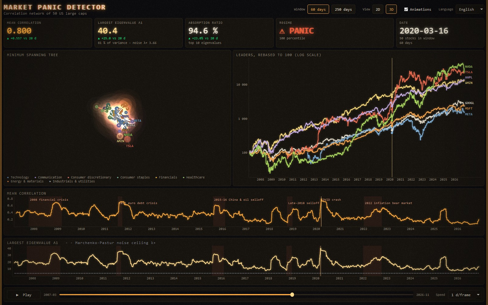
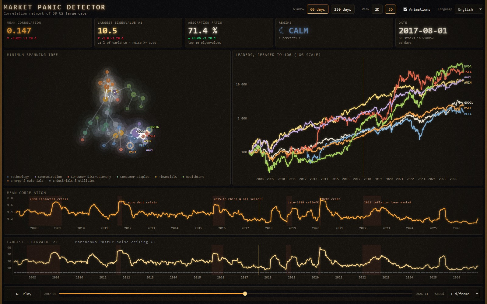
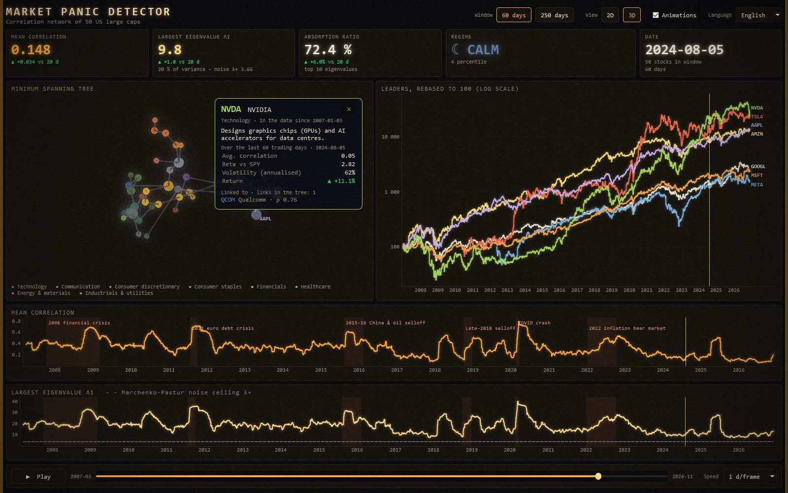
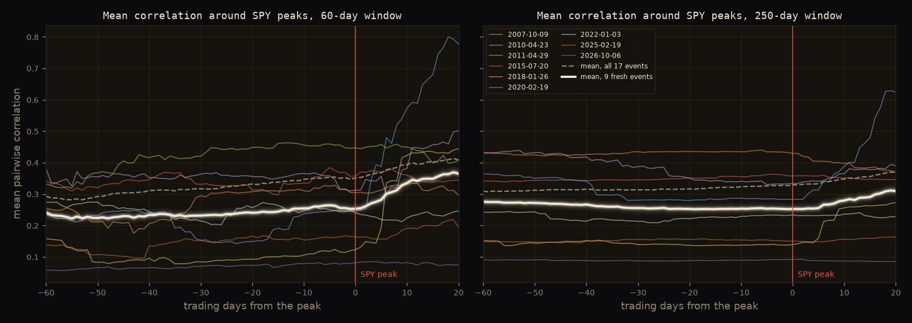

[English](README.md) | [Français](README.fr.md) | [中文](README.zh-CN.md)

# Market Panic Detector

**When the US market panics, everything starts moving together.** This project measures that synchronisation on 50 large US stocks since 2007. It draws the correlation network day by day in a native desktop dashboard, and tests honestly whether it gives any warning before a crash.



## The idea

On a quiet day, stocks move fairly independently: Apple reacts to Apple news, Exxon to the oil price. Their correlation network is spread out, with sectors forming separate branches. In a crisis, one force dominates everything (fear, liquidity, forced selling). Stocks rise and fall together, and the network contracts into a single block.

| Calm: 1 August 2017 | Panic: 16 March 2020 |
|---|---|
|  |  |
| Mean correlation 0.15, λ1 = 10.5 (21 % of the variance) | Mean correlation 0.80, λ1 = 40.4 (81 % of the variance) |

## What each indicator measures, simply

All indicators are computed every day on a rolling window of **60 or 250 trading days** of daily log returns, never on prices.

| Indicator | In plain words |
|---|---|
| **Mean correlation** | The average of the 1 225 pairwise correlations between the 50 stocks. 0 = they ignore each other, 1 = they move as one. |
| **Largest eigenvalue λ1** | The strength of the single biggest common force in the market (the "market factor"). With 50 stocks it ranges from about 1 (no common force) to 50 (everything is one stock). λ1 / N is the share of all movement this one force explains. |
| **Absorption ratio** (Kritzman et al., 2011) | The share of total variance absorbed by the 10 strongest forces (N/5). High = a fragile market, where a shock spreads everywhere. |
| **Marchenko-Pastur ceiling λ+** | The largest eigenvalue you would see by pure chance with N stocks and T days of random noise: λ+ = (1 + √(N/T))². Drawn as a dashed line: λ1 far above it means the common force is real, not noise. |
| **Minimum spanning tree** (Mantegna, 1999) | Each stock is linked to the one it moves most like, using the distance d = √(2(1 − ρ)), keeping the 49 shortest links that connect all 50 stocks. Short links mean a tight market. |
| **Regime** CALM / TENSION / PANIC | Today's mean correlation ranked against **all past days only** (no look-ahead). Below the 60th percentile: CALM; 60th to 90th: TENSION; above the 90th: PANIC. Thresholds are configurable. |

## The dashboard

A native window built with PySide6 + pyqtgraph, with OpenGL for the 3-D network. No browser is needed.

- **Top**: big-number panels for mean correlation, λ1, absorption ratio, regime (with icon) and date. Each shows its 20-day change with ▲ / ▼, never colour alone.
- **Centre left**: the minimum spanning tree at the selected date, **in 3-D**.
  - Drag to rotate around it, scroll to zoom, right-drag to pan, double-click to reset. In CALM it turns slowly on its own.
  - Nodes are coloured by sector and sized by their number of links. Farther nodes are dimmer, for depth.
  - The 7 leaders (NVDA, AAPL, MSFT, GOOGL, AMZN, META, TSLA) have a glow and a label in their own colour.
  - Nodes keep stable positions and glide from one date to the next.
  - A **2D / 3D** switch in the header flips to a flat view. Without OpenGL, the window uses the 2-D view on its own.
- **Click a bubble** to open the company's card:
  - what the company does, in one sentence (in all 3 languages);
  - the companies it is linked to in the tree, with their correlation ρ (click one to open its card);
  - its average correlation with the other stocks, its beta to SPY, its annualised volatility and its return over the window.

  The bubble and its links are highlighted, and the card follows the date. Close it with ✕ or `Esc`.
- **Centre right**: the 7 leaders' prices rebased to 100 on a log scale, with the date line.
- **Bottom**: mean correlation and λ1 in two separate charts, with the Marchenko-Pastur ceiling and the annotated crises (2008, 2011, 2015-16, late 2018, COVID 2020, 2022). Below them, a time slider with play / pause and speed.
- **Interactions**:
  - hovering a node shows ticker, name, sector and links;
  - a crosshair shows values over the charts;
  - clicking a chart jumps to that date;
  - mouse-wheel zoom on the network, double-click to reset;
  - 60 / 250-day window switch, live language switch **EN / FR / 中文**;
  - the animations can be turned off.



**Mood.** The look follows the cover of *I'm Wide Awake* by dxn1al: a sleepless night under sodium street lamps.
- **Light and colours**: a near-black sky, one warm amber light, concrete greys and ochre side bands.
- **Photo finish**: soft bokeh glows and a little film grain with darkened corners.
- **By regime**:
  - CALM: the nodes breathe slowly in night blue (one cycle every 3 s);
  - TENSION: the pulse quickens and the links warm to amber;
  - PANIC: the pulse races, the links glow taillight red, and the title and regime badge glitch.

## Installation

Python 3.11 or newer.

```powershell
cd MarketPanicDetector
py -3.11 -m venv .venv            # or: python3 -m venv .venv
.venv\Scripts\activate            # macOS / Linux: source .venv/bin/activate
pip install -r requirements.txt
pip install -e .
```

## Usage

```powershell
python scripts/run_analysis.py    # download prices, precompute everything, write reports/findings.md
python -m panic_detector          # open the dashboard
```

- **Data**: the first run downloads daily adjusted closes from Yahoo Finance (`yfinance`) in a single grouped request. It caches them in `data/cache/` and retries with a growing delay if rate-limited. Later runs work offline.
- **Re-downloading**: add `--refresh` to either command to download again.
- **Precomputed results**: metrics, trees and node positions are precomputed once (about 90 s) and cached. The dashboard only reads them.
- **Dashboard options**:
  - `--window 250`: start on the 250-day window;
  - `--lang fr` or `--lang zh_CN`: start in French or Chinese;
  - `--date 2020-03-16`: start at that date;
  - `--view 2d` or `--view 3d`: network view at start (default: 3-D when OpenGL is available);
  - `--no-animations`: start with animations off.
- **Keyboard**: `Space` plays / pauses, `←` `→` move one day, `Esc` closes the company card.
- **Screenshots**: `python scripts/make_screenshots.py` regenerates the images in `docs/img/`.
- **Settings**: universe in `config/universe.yaml`; windows, thresholds and crises in `config/settings.yaml`.

## Results: does the indicator anticipate crises?

**No. It reacts during the crisis; it does not anticipate it.** The full report, with tables and figures, is in [reports/findings.md](reports/findings.md) (data through 23 November 2026).

- **Events**: there are 17 SPY declines of more than 10 % since 2007. Nine are "fresh", meaning not an aftershock of a previous fall.
- **At the peak**: at the SPY peak of each fresh event, the 60-day regime was CALM 8 times (the 9th was still warming up in 2007), never TENSION or PANIC.
  - The 60-day change in correlation before the peak was ordinary: median at the 62nd percentile of all 60-day changes.
- **After the peak**: only 4 of the 9 fresh events reached PANIC, always *after* SPY had already fallen 10 %, by 2 to 32 trading days (median 6). 85 % of all PANIC days happen when SPY is already more than 10 % below its high.
- **No forward predictability**: the 20-day change in mean correlation does not predict SPY's next 20 days. Non-overlapping samples give r = −0.02 (p = 0.77); Newey-West gives p = 0.60.
- **One weak result, with the opposite sign**: the *level* of the 250-day correlation is nominally significant (Newey-West p = 0.015, but non-overlapping p = 0.064, 1 test out of 6). Higher correlation was followed by slightly *higher* returns, consistent with Pollet & Wilson (2010). It is not a crash warning.
- **Same period, the link is strong**: correlation rises in the very weeks the market falls (r = −0.49).



Mean correlation and λ1 are a **thermometer, not a barometer**. They show precisely how synchronised the market is now, but in this sample they gave no advance warning.

## Limitations

- **Survivorship bias**: the 50 stocks are today's large caps, chosen with today's knowledge. A 2007 investor would have picked a different list, including firms that later shrank or disappeared.
- **Not a buy or sell signal**: the indicator describes the structure of the market. The test above found no forecasting power, and nothing here is investment advice.
- **Few events**: 17 drawdowns (9 fresh), several of them parts of the same crisis. Rolling windows are strongly autocorrelated.
- **Hindsight**: peaks are only known after the fact. The regime percentile is expanding, so milder late crises (2018, 2022, 2025) are judged against 2008 and 2020 and rarely reach PANIC.
- **Data**: Yahoo Finance adjusted closes, not checked against a second source. Stocks listed after 2007 (V, AVGO, TSLA, META) enter a window once they have 95 % of its days.
- **Company descriptions** are short general summaries written for this project, not official company texts.

## Project layout

```
config/            universe.yaml (50 stocks, 8 sector groups, SPY), settings.yaml
src/panic_detector/
  data.py          download + Parquet cache + retries
  metrics.py       rolling correlation metrics
  network.py       distance, minimum spanning tree, stable 2-D and 3-D layouts
  regime.py        past-only percentile regime
  eventstudy.py    drawdown events, predictive tests
  pipeline.py      precompute and cache everything
  report.py        reports/findings.md and its figures
  i18n/            en.json, fr.json, zh_CN.json (all interface text and company descriptions)
  ui/              PySide6 + pyqtgraph dashboard (network_view3d.py: OpenGL view; company_card.py)
scripts/           run_analysis.py, make_screenshots.py
tests/             pytest suite (simulated factor model, MST, no look-ahead, offline cache, i18n, UI)
```

Run the tests with `python -m pytest`. They run headless, where OpenGL is not available, so the 3-D window test is skipped there. To run it in a real window:

```powershell
$env:QT_QPA_PLATFORM = "windows"; python -m pytest tests/test_network3d.py
```

## Licence

[MIT](LICENSE)
