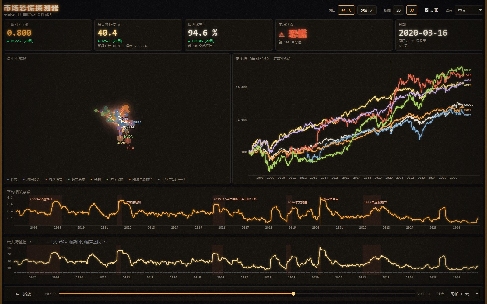
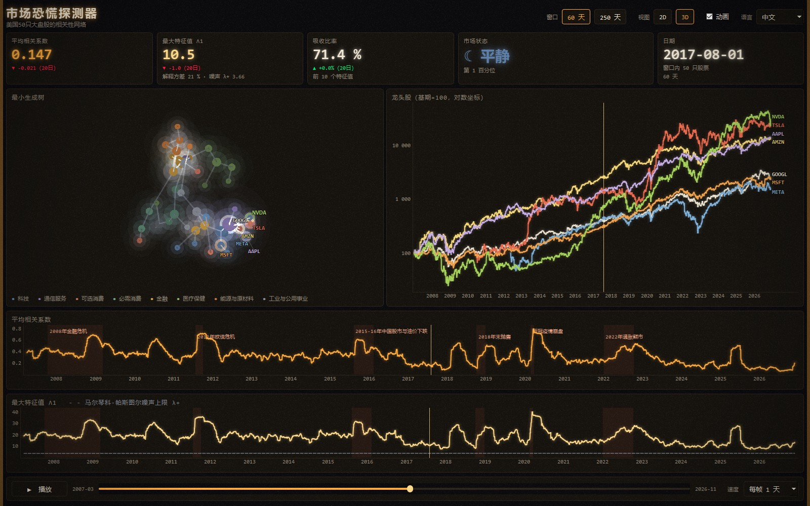
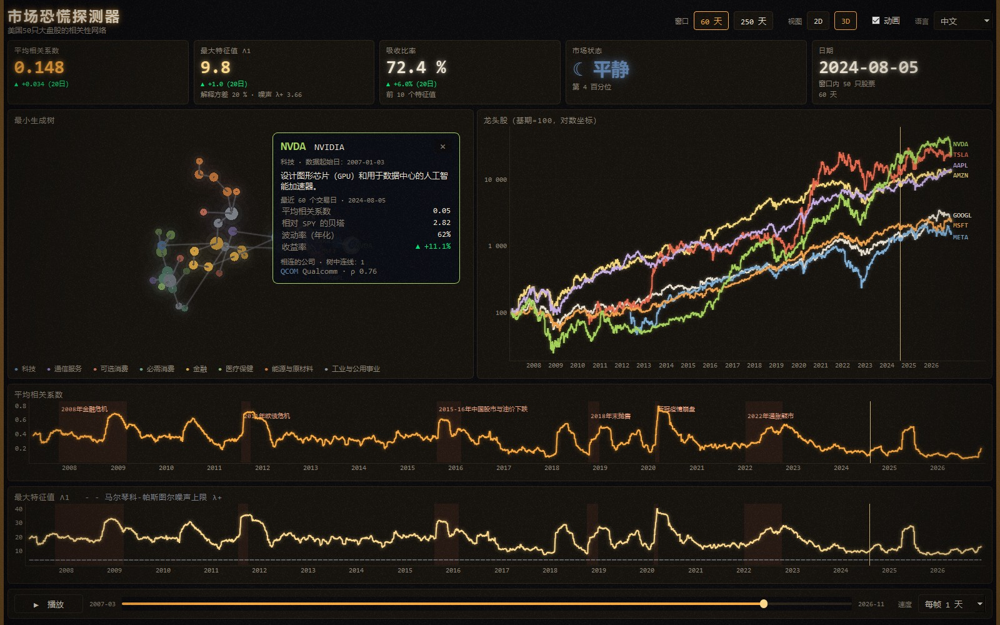
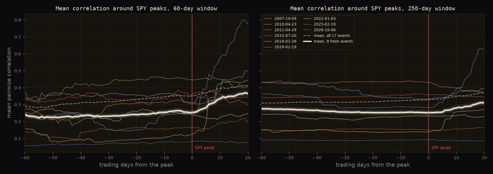

[English](README.md) | [Français](README.fr.md) | [中文](README.zh-CN.md)

# 市场恐慌探测器（Market Panic Detector）

**美国股市恐慌时，所有股票会一起涨跌。** 本项目自 2007 年起，用 50 只美国大盘股衡量这种"同步性"。它在原生桌面看板中逐日绘制股票之间的相关性网络，并如实检验：它能否在暴跌之前发出预警。



## 基本思路

平静的日子里，各只股票的走势相对独立：苹果对苹果的消息作出反应，埃克森美孚对油价作出反应。此时相关性网络是舒展的，各行业形成各自的分支。危机中，一股力量压倒一切（恐惧、流动性需求、被迫抛售）。股票同涨同跌，网络收缩成一个整体。

| 平静：2017 年 8 月 1 日 | 恐慌：2020 年 3 月 16 日 |
|---|---|
|  |  |
| 平均相关系数 0.15，λ1 = 10.5（解释 21% 的方差） | 平均相关系数 0.80，λ1 = 40.4（解释 81% 的方差） |

## 各项指标的通俗解释

所有指标每天都在 **60 或 250 个交易日**的滚动窗口上计算，使用每日对数收益率，从不使用价格本身。

| 指标 | 通俗解释 |
|---|---|
| **平均相关系数** | 50 只股票两两之间共 1 225 个相关系数的平均值。0 = 互不相关，1 = 完全同步。 |
| **最大特征值 λ1** | 市场中最大的那股共同力量（"市场因子"）的强度。50 只股票时，它介于约 1（没有共同力量）到 50（所有股票如同一只）之间。λ1 / N 是这一股力量单独解释的波动占比。 |
| **吸收比率**（Kritzman 等，2011） | 最强的 10 股力量（N/5）所吸收的总方差占比。数值高 = 市场脆弱，冲击会迅速蔓延到各处。 |
| **马尔琴科-帕斯图尔噪声上限 λ+** | 用 N 只股票、T 天的纯随机噪声时，偶然会出现的最大特征值：λ+ = (1 + √(N/T))²。图中以虚线表示：λ1 远高于它，说明共同力量是真实的，而不是噪声。 |
| **最小生成树**（Mantegna，1999） | 用距离 d = √(2(1 − ρ)) 把每只股票与走势最相似的股票相连，保留连通全部 50 只股票的 49 条最短连线。连线越短，市场越紧密。 |
| **市场状态** 平静 / 紧张 / 恐慌 | 把当天的平均相关系数**只与过去的数据**比较得到的百分位（不使用任何未来信息）。低于第 60 百分位为平静，第 60 至 90 百分位为紧张，高于第 90 百分位为恐慌。阈值可在配置中修改。 |

## 看板

使用 PySide6 + pyqtgraph 构建的原生窗口，3D 网络图使用 OpenGL，无需浏览器。

- **顶部**：大字面板，显示平均相关系数、λ1、吸收比率、市场状态（带图标）和日期。每个面板都显示 20 日变化，并附 ▲ / ▼ 箭头，从不只用颜色表示。
- **中部左侧**：所选日期的最小生成树，**以 3D 显示**。
  - 拖动鼠标可围绕旋转，滚轮缩放，右键拖动平移，双击复位。平静时会自动缓慢旋转。
  - 节点按行业着色，大小取决于连线数量。较远的节点颜色更暗，以呈现纵深。
  - 7 只龙头股（NVDA、AAPL、MSFT、GOOGL、AMZN、META、TSLA）带有专属颜色的光晕和标签。
  - 节点位置保持稳定，日期切换时会平滑移动。
  - 标题栏中的 **2D / 3D** 按钮可切换为平面视图。没有 OpenGL 时，窗口会自动使用 2D 视图。
- **点击气泡**即可打开该公司的信息卡：
  - 一句话介绍公司业务（三种语言）；
  - 在树中与它相连的公司及其相关系数 ρ（点击可打开对方的信息卡）；
  - 窗口期内它与其他股票的平均相关系数、相对 SPY 的贝塔、年化波动率和收益率。

  所选气泡及其连线会高亮显示，信息卡随日期更新。点击 ✕ 或按 `Esc` 关闭。
- **中部右侧**：7 只龙头股的价格（基期 = 100，对数坐标），并带有当前日期的竖线。
- **底部**：平均相关系数和 λ1 分别画在两张独立的图中，标出马尔琴科-帕斯图尔上限和历次危机（2008、2011、2015-16、2018 年末、2020 新冠、2022）。图下方是时间滑块，带播放 / 暂停和速度选择。
- **交互**：
  - 鼠标悬停在节点上，显示代码、名称、行业和连线数；
  - 在图表上有十字准线和数值；
  - 点击图表可跳转到该日期；
  - 在网络图上可用滚轮缩放，双击复位；
  - 可切换 60 / 250 日窗口，可即时切换语言 **EN / FR / 中文**；
  - 可以关闭动画。



**氛围。** 视觉风格取自 dxn1al 的 *I'm Wide Awake* 封面：钠灯路灯下的不眠之夜。
- **光线与色彩**：近乎全黑的夜空、一束温暖的琥珀色灯光、混凝土的灰色和两侧的赭色边框。
- **照片质感**：像远处路灯一样柔和的光晕（散景）、轻微的胶片颗粒和变暗的四角。
- **随市场状态变化**：
  - 平静：节点以夜蓝色缓慢"呼吸"（约每 3 秒一次）；
  - 紧张：脉动加快，连线变为琥珀色；
  - 恐慌：脉动急促，连线泛起尾灯般的红光，标题和状态徽章出现故障闪烁效果。

## 安装

需要 Python 3.11 或更高版本。

```powershell
cd MarketPanicDetector
py -3.11 -m venv .venv            # 或：python3 -m venv .venv
.venv\Scripts\activate            # macOS / Linux：source .venv/bin/activate
pip install -r requirements.txt
pip install -e .
```

## 使用方法

```powershell
python scripts/run_analysis.py    # 下载价格、预先计算全部结果、生成 reports/findings.md
python -m panic_detector          # 打开看板
```

- **数据**：首次运行时，通过一次批量请求从 Yahoo Finance（`yfinance`）下载每日复权收盘价，保存在 `data/cache/` 中。遇到请求频率限制时，会以递增的间隔自动重试。之后的运行可以离线进行。
- **重新下载**：在任一命令后加 `--refresh`。
- **预计算结果**：各项指标、生成树和节点位置只计算一次（约 90 秒）并缓存，看板只负责读取。
- **看板选项**：
  - `--window 250`：以 250 日窗口启动；
  - `--lang fr` 或 `--lang zh_CN`：以法语或中文启动；
  - `--date 2020-03-16`：从该日期开始；
  - `--view 2d` 或 `--view 3d`：启动时的网络视图（默认：有 OpenGL 时为 3D）；
  - `--no-animations`：关闭动画启动。
- **键盘**：`空格`播放 / 暂停，`←` `→` 前后移动一天，`Esc` 关闭公司信息卡。
- **截图**：`python scripts/make_screenshots.py` 会重新生成 `docs/img/` 中的图片。
- **配置**：股票池在 `config/universe.yaml`；窗口、阈值和危机日期在 `config/settings.yaml`。

## 结果：这个指标能预测危机吗？

**不能。它在危机期间作出反应，但无法提前预判。** 完整报告（含表格和图表）见 [reports/findings.md](reports/findings.md)（英文，数据截至 2026 年 11 月 23 日）。

- **事件**：自 2007 年以来，SPY 共有 17 次超过 10% 的下跌，其中 9 次是"独立"的，即不是前一次下跌的余震。
- **在高点时**：在每次独立下跌的 SPY 高点当天，60 日窗口的市场状态有 8 次为平静（第 9 次在 2007 年，仍处于预热期），从未出现紧张或恐慌。
  - 高点前 60 天相关系数的变化很普通：中位数位于所有 60 日变化的第 62 百分位。
- **高点之后**：9 次独立下跌中只有 4 次进入恐慌状态，而且都发生在 SPY 已经下跌 10% *之后*，滞后 2 到 32 个交易日（中位数 6 天）。85% 的恐慌日出现在 SPY 已比高点低 10% 以上的时候。
- **没有前瞻预测力**：平均相关系数的 20 日变化无法预测 SPY 未来 20 天的收益。不重叠样本 r = −0.02（p = 0.77），Newey-West 检验 p = 0.60。
- **唯一一个较弱、方向相反的结果**：250 日相关系数的*水平*在 Newey-West 检验下名义显著（p = 0.015），但不重叠样本不显著（p = 0.064），而且只是 6 项检验中的 1 项。相关性高之后，收益反而略*高*，与 Pollet & Wilson（2010）的结论一致。这并不是暴跌预警。
- **同期关系很强**：市场下跌的那几周，相关性同时上升（r = −0.49）。



平均相关系数和 λ1 是**温度计，而不是气压计**。它们准确地显示市场此刻的同步程度，但在本样本中没有提供任何提前预警。

## 局限性

- **幸存者偏差**：这 50 只股票是今天的大盘股，是用今天的信息挑选的。2007 年的投资者会选出另一份名单，其中包括后来萎缩或消失的公司。
- **不是买入或卖出信号**：该指标描述的是市场结构。上面的检验没有发现任何预测能力，本项目内容也不构成投资建议。
- **事件很少**：17 次下跌（9 次独立），其中好几次属于同一场危机。滚动窗口的数据高度自相关。
- **事后视角**：高点只有在事后才能确定。市场状态的百分位是累积计算的：较晚、较温和的危机（2018、2022、2025）要与 2008 和 2020 相比，因此很少达到恐慌。
- **数据**：使用 Yahoo Finance 的复权收盘价，未与其他数据源交叉核对。2007 年以后上市的股票（V、AVGO、TSLA、META）在窗口内数据覆盖率达到 95% 后才会加入。
- **公司介绍**：为本项目撰写的简短概述，并非公司官方文字。

## 项目结构

```
config/            universe.yaml（50 只股票、8 个行业组、SPY）、settings.yaml
src/panic_detector/
  data.py          下载 + Parquet 缓存 + 重试
  metrics.py       滚动相关性指标
  network.py       距离、最小生成树、稳定的 2D 和 3D 布局
  regime.py        仅基于历史数据的市场状态
  eventstudy.py    下跌事件与预测检验
  pipeline.py      预先计算并缓存全部结果
  report.py        reports/findings.md 及其图表
  i18n/            en.json、fr.json、zh_CN.json（界面文字和公司介绍）
  ui/              PySide6 + pyqtgraph 看板（network_view3d.py：OpenGL 视图；company_card.py）
scripts/           run_analysis.py、make_screenshots.py
tests/             pytest 测试（模拟因子模型、生成树、无前视、离线缓存、多语言、界面）
```

运行测试：`python -m pytest`。测试在无界面模式下运行，该模式没有 OpenGL，因此会跳过 3D 窗口测试。如需在真实窗口中运行：

```powershell
$env:QT_QPA_PLATFORM = "windows"; python -m pytest tests/test_network3d.py
```

## 许可证

[MIT](LICENSE)
