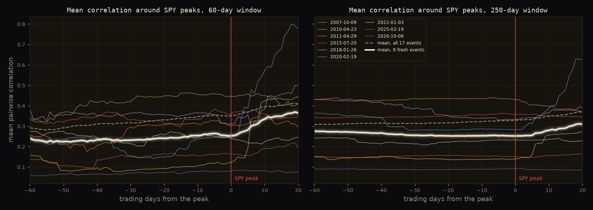
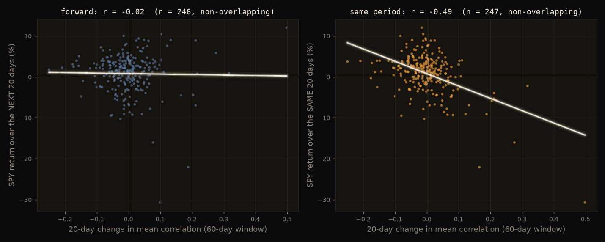

# Findings: does the correlation indicator anticipate crises?

_Generated by `scripts/run_analysis.py` on 2026-11-24; data through 2026-11-23._

## Verdict

- **60-day window** — anticipation: no forward test is significant at 5 %. Reaction: the same-period correlation between the change in mean correlation and SPY's return is r = -0.49 (p <0.001).
- **250-day window** — anticipation: only one of the two methods is significant at 5 % for mean_corr level (Newey-West p = 0.015, non-overlapping p = 0.064). Reaction: the same-period correlation between the change in mean correlation and SPY's return is r = -0.45 (p <0.001).

## Interpretation

<!-- interpretation:start -->
_Written for data through 2026-11-23. Numbers below come from the tables in this report._

**The indicator reacts to crises. It does not anticipate them.**

- **Nothing stands out before the peak.** On the 9 fresh events, the 60-day mean correlation averaged 0.24 sixty days before the SPY peak and 0.25 at the peak. Its pre-peak change ranks at the 62nd percentile of all 60-day changes (median), which is ordinary. None of the fresh events was in TENSION or PANIC at the peak: 8 were CALM and 1 was still in warm-up (October 2007).
- **The apparent pre-peak rise is an artefact of aftershocks.** Over all 17 events, 13 show an above-median pre-peak rise (sign test p = 0.049). The excess comes from new legs down inside 2008, late 2015 and 2022, where correlation was already high from the previous fall. On fresh events it disappears (6 of 9, p = 0.51).
- **After the peak, correlation jumps.** On fresh events the 60-day mean correlation goes from 0.25 at the peak to 0.37 twenty days later. Only 4 of the 9 fresh events reached PANIC, always *after* SPY had already fallen 10 % (by 2 to 32 trading days, median 6). 85 % of all PANIC days fall when SPY is already more than 10 % below its high.
- **No forward predictability from changes.** The 20-day change in mean correlation or in the absorption ratio does not predict SPY's next 20 days (|r| ≤ 0.05, every p > 0.5, both windows, both methods).
- **One weak, opposite-signed result.** The *level* of the 250-day mean correlation is nominally significant with Newey-West (p = 0.015) but not on non-overlapping samples (p = 0.064). It is 1 of 6 tests. Its sign is positive: higher correlation was followed by slightly *higher* 20-day returns (+0.56 % per standard deviation). That matches Pollet & Wilson (2010, *Journal of Financial Economics*), who find that average correlation is a priced risk that peaks near market lows. It is the opposite of a crash warning, and fragile here.
- **Same period, the link is strong.** Correlation rises in the very weeks the market falls: r = −0.49 (60-day window) and −0.45 (250-day window), p < 0.001.

**Bottom line.** Mean correlation and λ1 are a thermometer, not a barometer. They show how synchronised the market is *now*, confirm a broad sell-off within days (2008, 2011, 2015, 2020), and show that other drawdowns (2018, 2022, 2025) stayed far less synchronised. In this sample they gave no advance warning, and the PANIC regime is not a trading signal.
<!-- interpretation:end -->

## Method

- **Events**: every SPY decline of more than 10 % (adjusted closes), found with a zig-zag rule: a peak is confirmed by a 10 % fall, the trough by a 10 % rebound. A new all-time high is not required, so 2010 and 2011 count as separate events.
- **Fresh events**: events whose pre-peak window (60 trading days) starts after the previous event ended. Aftershocks start from an indicator that is already high, which would bias the 'did it rise before the peak?' question.
- **Peak dates are only known in hindsight.** The date the decline first crossed −10 % is the first moment an observer could know an event was under way.
- **Pre-peak change percentile**: the change in mean correlation over the 60 days before the peak, ranked against all 60-day changes in the sample (50 = ordinary, > 90 = unusually large rise).
- **Predictive test**: SPY's forward 20-day log return regressed on three signals known at t: the 20-day change in mean correlation, its level, and the 20-day change in the absorption ratio. (a) Pearson and Spearman correlations on non-overlapping 20-day samples, with the range of r over the 20 possible starting days; (b) OLS on all days with Newey-West (HAC, 20 lags) standard errors; the slope is the forward return per one standard deviation of the signal.
- **Same-period test**: identical, but against SPY's return over the same past 20 days: this measures reaction, not anticipation.

## 1. SPY drawdown events

| peak | −10 % crossed | trough | depth | fresh |
|---|---|---|---|---|
| 2007-10-09 | 2008-01-08 | 2008-03-10 | -17.8% | yes |
| 2008-05-19 | 2008-06-27 | 2008-10-10 | -37.5% | aftershock |
| 2008-10-13 | 2008-10-15 | 2008-10-27 | -17.2% | aftershock |
| 2008-11-04 | 2008-11-11 | 2008-11-20 | -24.9% | aftershock |
| 2009-01-06 | 2009-01-20 | 2009-03-09 | -27.1% | aftershock |
| 2010-04-23 | 2010-05-20 | 2010-07-02 | -15.7% | yes |
| 2011-04-29 | 2011-08-04 | 2011-10-03 | -18.6% | yes |
| 2015-07-20 | 2015-08-24 | 2015-08-25 | -11.9% | yes |
| 2015-11-03 | 2016-01-15 | 2016-02-11 | -12.8% | aftershock |
| 2018-01-26 | 2018-02-08 | 2018-02-08 | -10.1% | yes |
| 2018-09-20 | 2018-12-14 | 2018-12-24 | -19.3% | aftershock |
| 2020-02-19 | 2020-02-27 | 2020-03-23 | -33.7% | yes |
| 2022-01-03 | 2022-02-22 | 2022-03-08 | -12.9% | yes |
| 2022-03-29 | 2022-04-29 | 2022-06-16 | -20.6% | aftershock |
| 2022-08-16 | 2022-09-20 | 2022-10-12 | -16.7% | aftershock |
| 2025-02-19 | 2025-03-13 | 2025-04-08 | -18.8% | yes |
| 2026-10-06 | 2026-11-20 | 2026-11-20 | -11.5% | yes |

## 2. Event study

### 60-day window

| peak | fresh | corr t−60 | corr at peak | corr t+20 | corr at trough | pre-peak change pctile | regime at peak | days to −10 % | days to 1st PANIC | PANIC vs −10 % (days) |
|---|---|---|---|---|---|---|---|---|---|---|
| 2007-10-09 | yes | 0.33 | 0.45 | 0.41 | 0.33 | 84 | warmup | 62 | – | – |
| 2008-05-19 | – | 0.36 | 0.36 | 0.31 | 0.53 | 57 | calm | 28 | 92 | +64 |
| 2008-10-13 | – | 0.30 | 0.60 | 0.66 | 0.63 | 95 | panic | 2 | 0 | -2 |
| 2008-11-04 | – | 0.32 | 0.65 | 0.69 | 0.68 | 96 | panic | 5 | 0 | -5 |
| 2009-01-06 | – | 0.54 | 0.67 | 0.60 | 0.47 | 86 | panic | 9 | 0 | -9 |
| 2010-04-23 | yes | 0.38 | 0.31 | 0.50 | 0.58 | 29 | calm | 19 | 51 | +32 |
| 2011-04-29 | yes | 0.25 | 0.30 | 0.30 | 0.71 | 74 | calm | 67 | 69 | +2 |
| 2015-07-20 | yes | 0.34 | 0.36 | 0.34 | 0.50 | 62 | calm | 25 | 32 | +7 |
| 2015-11-03 | – | 0.34 | 0.60 | 0.37 | 0.44 | 93 | tension | 50 | – | – |
| 2018-01-26 | yes | 0.16 | 0.12 | 0.44 | 0.42 | 41 | calm | 9 | – | – |
| 2018-09-20 | – | 0.30 | 0.13 | 0.28 | 0.43 | 10 | calm | 59 | – | – |
| 2020-02-19 | yes | 0.23 | 0.25 | 0.78 | 0.73 | 62 | calm | 6 | 10 | +4 |
| 2022-01-03 | yes | 0.27 | 0.24 | 0.25 | 0.27 | 42 | calm | 34 | – | – |
| 2022-03-29 | – | 0.25 | 0.27 | 0.31 | 0.48 | 67 | calm | 22 | – | – |
| 2022-08-16 | – | 0.41 | 0.42 | 0.43 | 0.48 | 61 | tension | 24 | – | – |
| 2025-02-19 | yes | 0.14 | 0.16 | 0.19 | 0.32 | 67 | calm | 16 | – | – |
| 2026-10-06 | yes | 0.06 | 0.08 | 0.07 | 0.18 | 66 | calm | 33 | – | – |

- Pre-peak rise larger than the median 60-day change: 13 of 17 events (sign test p = 0.049); fresh events only: 6 of 9 (p = 0.508, median percentile 62).
- Regime at the peak of the 9 fresh events: PANIC 0, TENSION 0, CALM 8, WARMUP 1.
- Fresh events that reached PANIC: 4 of 9; it came +2 to +32 trading days after the −10 % line was crossed (median +6).
- Precision of PANIC days: 248 PANIC days, of which 85% occurred while SPY was already more than 10 % below its running high (97% more than 5 % below).

### 250-day window

| peak | fresh | corr t−60 | corr at peak | corr t+20 | corr at trough | pre-peak change pctile | regime at peak | days to −10 % | days to 1st PANIC | PANIC vs −10 % (days) |
|---|---|---|---|---|---|---|---|---|---|---|
| 2007-10-09 | yes | – | – | – | 0.37 | – | – | 62 | – | – |
| 2008-05-19 | – | 0.38 | 0.37 | 0.37 | 0.43 | 41 | warmup | 28 | – | – |
| 2008-10-13 | – | 0.36 | 0.47 | 0.52 | 0.49 | 94 | warmup | 2 | – | – |
| 2008-11-04 | – | 0.35 | 0.51 | 0.56 | 0.55 | 97 | warmup | 5 | – | – |
| 2009-01-06 | – | 0.43 | 0.56 | 0.56 | 0.56 | 95 | panic | 9 | 0 | -9 |
| 2010-04-23 | yes | 0.43 | 0.33 | 0.39 | 0.42 | 7 | calm | 19 | – | – |
| 2011-04-29 | yes | 0.43 | 0.43 | 0.37 | 0.50 | 54 | calm | 67 | – | – |
| 2015-07-20 | yes | 0.34 | 0.36 | 0.35 | 0.39 | 74 | calm | 25 | – | – |
| 2015-11-03 | – | 0.35 | 0.43 | 0.44 | 0.44 | 92 | calm | 50 | – | – |
| 2018-01-26 | yes | 0.15 | 0.14 | 0.27 | 0.25 | 41 | calm | 9 | – | – |
| 2018-09-20 | – | 0.34 | 0.32 | 0.34 | 0.39 | 39 | calm | 59 | – | – |
| 2020-02-19 | yes | 0.36 | 0.28 | 0.62 | 0.60 | 10 | calm | 6 | 17 | +11 |
| 2022-01-03 | yes | 0.24 | 0.23 | 0.23 | 0.24 | 46 | calm | 34 | – | – |
| 2022-03-29 | – | 0.23 | 0.25 | 0.26 | 0.33 | 76 | calm | 22 | – | – |
| 2022-08-16 | – | 0.30 | 0.34 | 0.37 | 0.38 | 84 | calm | 24 | – | – |
| 2025-02-19 | yes | 0.15 | 0.15 | 0.16 | 0.22 | 59 | calm | 16 | – | – |
| 2026-10-06 | yes | 0.09 | 0.09 | 0.09 | 0.11 | 58 | calm | 33 | – | – |

- Pre-peak rise larger than the median 60-day change: 10 of 16 events (sign test p = 0.454); fresh events only: 4 of 8 (p = 1.000, median percentile 50).
- Regime at the peak of the 9 fresh events: PANIC 0, TENSION 0, CALM 8, NO DATA 1.
- Fresh events that reached PANIC: 1 of 9; it came +11 trading days after the −10 % line was crossed.
- Precision of PANIC days: 415 PANIC days, of which 49% occurred while SPY was already more than 10 % below its running high (64% more than 5 % below).

## 3. Predictive test

### 60-day window

| test | signal | n (non-overlap) | Pearson r | p | Spearman ρ | p (ρ) | r range (offsets) | n (daily) | NW slope (%/sd) | NW t | NW p | R² |
|---|---|---|---|---|---|---|---|---|---|---|---|---|
| forward | Δ mean_corr | 246 | -0.019 | 0.766 | -0.003 | 0.968 | -0.13 … +0.08 | 4905 | -0.16 | -0.53 | 0.597 | 0.001 |
| forward | mean_corr level | 247 | +0.080 | 0.212 | +0.099 | 0.120 | +0.02 … +0.09 | 4925 | +0.30 | +1.22 | 0.221 | 0.004 |
| forward | Δ absorption_ratio | 246 | -0.009 | 0.883 | +0.000 | 0.996 | -0.12 … +0.07 | 4905 | -0.12 | -0.42 | 0.674 | 0.001 |
| same period | Δ mean_corr | 247 | -0.487 | <0.001 | -0.292 | <0.001 | -0.50 … -0.31 | 4925 | -2.06 | -5.45 | <0.001 | 0.188 |

### 250-day window

| test | signal | n (non-overlap) | Pearson r | p | Spearman ρ | p (ρ) | r range (offsets) | n (daily) | NW slope (%/sd) | NW t | NW p | R² |
|---|---|---|---|---|---|---|---|---|---|---|---|---|
| forward | Δ mean_corr | 236 | -0.044 | 0.500 | +0.015 | 0.817 | -0.11 … +0.12 | 4715 | +0.01 | +0.04 | 0.969 | 0.000 |
| forward | mean_corr level | 237 | +0.121 | 0.064 | +0.120 | 0.066 | +0.10 … +0.14 | 4735 | +0.56 | +2.44 | 0.015 | 0.014 |
| forward | Δ absorption_ratio | 236 | -0.022 | 0.737 | -0.001 | 0.985 | -0.11 … +0.12 | 4715 | -0.02 | -0.04 | 0.967 | 0.000 |
| same period | Δ mean_corr | 237 | -0.454 | <0.001 | -0.324 | <0.001 | -0.58 … -0.43 | 4735 | -2.35 | -6.56 | <0.001 | 0.241 |

6 forward tests are run in total (3 signals × 2 windows): at the 5 % level, 0.3 false positives are expected by chance alone.

## Caveats

- **Survivorship bias**: the 50 stocks are today's large caps, chosen with hindsight.
- **Few events**: 17 drawdowns (9 fresh), several of them parts of the same crisis.
- **Peaks are chosen with hindsight**; only the −10 % crossing date is observable in real time.
- **Overlapping windows**: rolling 60/250-day statistics are highly autocorrelated; Newey-West and non-overlapping samples address this only partially.
- **The regime percentile is expanding**: crises are judged against everything seen before, so later, milder crises (2018, 2022) rarely reach PANIC.
- This is a description of market structure, **not a buy or sell signal**.
